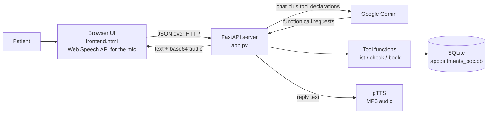
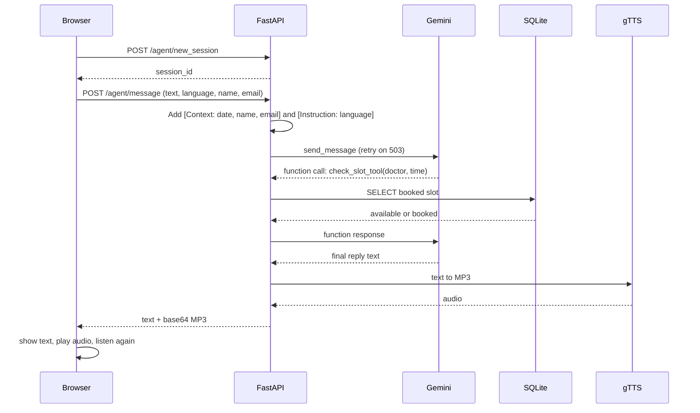

# AI Medical Assist: "Sarah", a multilingual AI hospital receptionist

A voice-and-chat web app where a patient talks to **Sarah**, an AI receptionist for *City Hospital*.
Sarah can list doctors, check whether a time slot is free, and **book an appointment**, in
**English, Hindi or Telugu**. Replies come back as text and as spoken audio.

> **Status: proof of concept (POC).** It is meant for learning and demos, not for real patient data.
> See [Security and privacy](#security-and-privacy) and [Known limitations](#known-limitations) before going further.

---

## Table of contents

1. [Features](#features)
2. [Tech stack](#tech-stack)
3. [Architecture](#architecture)
4. [Project structure](#project-structure)
5. [Prerequisites](#prerequisites)
6. [Setup, step by step](#setup-step-by-step)
7. [Run the app](#run-the-app)
8. [How to use it](#how-to-use-it)
9. [Configuration reference](#configuration-reference)
10. [API reference](#api-reference)
11. [Database](#database)
12. [How the AI part works](#how-the-ai-part-works)
13. [Verify your install](#verify-your-install)
14. [Troubleshooting](#troubleshooting)
15. [Security and privacy](#security-and-privacy)
16. [Known limitations](#known-limitations)
17. [Git and GitHub](#git-and-github)
18. [Generating the architecture document](#generating-the-architecture-document)

---

## Features

- Voice call style UI: patient name, email and language, a call timer, mic and camera toggles, **Tap to speak** button, and a typed-message fallback.
- Three languages: English (India), Hindi, Telugu. The language is enforced on every message.
- Gemini **function calling** with three tools: list doctors, check a slot, book a slot.
- Appointments stored in **SQLite**. A database `UNIQUE` constraint on (doctor, time) prevents double-booking.
- Spoken replies via **gTTS**; if audio generation fails, the browser's built-in voice is used instead.
- Automatic **retry with back-off** when Gemini answers `503 high demand`.
- Per-browser-call conversation memory (kept in server memory).

## Tech stack

| Layer | Technology | Version used when this README was written |
|---|---|---|
| Language | Python | 3.12 (3.10 or newer is required; the code uses `str \| None` syntax) |
| Web framework | FastAPI + Uvicorn | fastapi 0.162, uvicorn 0.54 |
| LLM | Google Gemini via `google-genai` | google-genai 2.34, default model `gemini-3.8-flash` |
| Text to speech | gTTS (Google Translate TTS, needs internet) | 2.5.4 |
| Database | SQLite (Python standard library) | n/a |
| Config | python-dotenv | 1.2 |
| Docs script | python-docx | 1.2 |
| Frontend | One HTML file, plain JavaScript, Web Speech API | n/a |

`requirements.txt` is not pinned. If a future release breaks something, install the versions in the table.

## Architecture

### Components



| Component | File | Responsibility |
|---|---|---|
| UI | `frontend.html` | Collects name, email and language; records speech with the browser's speech recognition; sends text to the API; shows the transcript; plays the audio reply. |
| API server | `app.py` | Routes, in-memory sessions, prompt building, Gemini calls with retry, the tool-calling loop, audio generation. |
| LLM | Gemini | Understands the request, decides which tool to call, writes the reply in the chosen language. |
| Tools | `app.py` | `list_doctors_tool`, `check_slot_tool`, `book_appointment_tool`. They validate input and talk to SQLite. |
| Database | `appointments_poc.db` | Tables `doctors` and `appointments`. Created automatically on first start. |
| TTS | gTTS | Turns the reply into an MP3, sent to the browser as base64. |

### One message, end to end



### Request flow in words

1. The browser loads `frontend.html` from `GET /`.
2. **Start voice call** asks for mic permission, calls `POST /agent/new_session`, then sends a first message ("Hello") so Sarah greets the patient.
3. For every message, the server appends two hidden blocks to the patient's text: a **Context** block (today's date, current time, patient name, patient email) and a **Language instruction**.
4. Gemini either answers directly or asks the server to run a tool. The server runs it against SQLite and returns the result to Gemini. This repeats for at most 5 rounds.
5. The final reply is cleaned (markdown symbols and anything in round brackets are removed) and turned into audio.
6. The browser shows the text, plays the audio, and starts listening again.

## Project structure

```
AI_Medical_Assit/
├── app.py                  # FastAPI backend, Gemini agent, tools, TTS
├── frontend.html           # Browser UI (served at "/")
├── doc_generate.py         # Optional: builds a Word architecture document
├── requirements.txt        # Python dependencies
├── .env.example            # Template for your secrets (safe to commit)
├── .env                    # YOUR secrets (you create it; never commit)
├── .gitignore              # Keeps secrets, venv and the database out of Git
├── README.md               # This file
└── appointments_poc.db     # Created automatically on first run (not committed)
```

## Prerequisites

- **Python 3.10 or newer** (3.12 recommended). Check with `python --version`.
- A **Google Gemini API key** (free to create in Google AI Studio).
- **Google Chrome or Microsoft Edge** for voice input. Firefox does not support the speech recognition used here; typing still works.
- A **microphone** (optional) and **internet access**. Internet is required for Gemini, for gTTS audio, and for the browser's speech recognition.

## Setup, step by step

### 1. Get the project

```bash
git clone <your-repo-url>
cd AI_Medical_Assit
```

or unzip the project folder and open a terminal inside it, in the same folder as `app.py`.

### 2. Create a virtual environment

**Windows (PowerShell):**
```powershell
python -m venv venv
.\venv\Scripts\Activate.ps1
```
If PowerShell says *running scripts is disabled*, run this once in the same window, then activate again:
```powershell
Set-ExecutionPolicy -Scope Process -ExecutionPolicy Bypass
```

**macOS / Linux:**
```bash
python3 -m venv venv
source venv/bin/activate
```

Your prompt should now start with `(venv)`.

### 3. Install the dependencies

```bash
pip install -r requirements.txt
```

### 4. Create your Gemini API key

1. Open <https://aistudio.google.com/apikey> and sign in with a Google account.
2. Click **Create API key** and copy it.
3. Treat it like a password. Do not paste it into chats, screenshots, or Git.

### 5. Create the `.env` file

In the same folder as `app.py`, copy the template.

**Windows (PowerShell):**
```powershell
Copy-Item .env.example .env
```
**macOS / Linux:**
```bash
cp .env.example .env
```

Open `.env` in an editor and put your key after the `=` sign, with no quotes and no spaces:

```env
GEMINI_API_KEY=paste_your_key_here
# GEMINI_MODEL=gemini-3.8-flash
```

Make sure the file is named exactly `.env` (not `.env.txt`). In Windows File Explorer, turn on *View > Show > File name extensions* to check.

## Run the app

```bash
python app.py
```

You should see:

```
INFO:     Uvicorn running on http://127.0.0.1:8000 (Press CTRL+C to quit)
```

Open **<http://127.0.0.1:8000>** in Chrome or Edge. Use `127.0.0.1` or `localhost`; the browser only allows microphone access on these local addresses or on HTTPS.

For development with auto-reload on code changes:

```bash
uvicorn app:app --reload --port 8000
```

Stop the server with **Ctrl + C**.

## How to use it

1. Enter **patient name**, a valid **email**, and choose a **language**.
2. Click **Start voice call** and **Allow** the microphone prompt.
3. Sarah greets you (text and voice). Then either:
   - click **Tap to speak**, say your request, and pause; or
   - type in the message box and press **Send**.
4. Example conversation:
   - "I need to see a heart doctor."
   - "Book tomorrow at 10 in the morning with Dr. Meera Patel."
   - Sarah checks the slot, repeats the doctor and time, and asks you to confirm.
   - "Yes, please book it." → the appointment is saved.
5. Use **Mute mic**, **Camera on/off** (a local preview only; no video is sent anywhere), and **End call** to finish.

Doctors available out of the box:

| Doctor | Specialty |
|---|---|
| Dr. Meera Patel | Cardiology |
| Dr. Arjun Rao | Neurology |

To add doctors, edit the list inside `init_db()` in `app.py` (or insert rows into the `doctors` table) and restart.

## Configuration reference

| Setting | Where | Default | Meaning |
|---|---|---|---|
| `GEMINI_API_KEY` | `.env` | none (required) | Your Gemini API key. |
| `GEMINI_MODEL` | `.env` | `gemini-3.8-flash` | Model ID. Change it if you get 404 or repeated 503 (see Troubleshooting). |
| Host / port | bottom of `app.py` | `127.0.0.1:8000` | Where the server listens. |
| `SLOT_FORMAT` | `app.py` | `%Y-%m-%d %H:%M` | Time format accepted by the tools. |
| Retry | `send_with_retry` in `app.py` | 4 tries, waits 2s / 4s / 8s | Only for Gemini `503` errors. |
| Tool rounds | `agent_message` in `app.py` | 5 | Safety cap on tool-call loops per message. |

Model names change over time. Check the current list at <https://ai.google.dev/gemini-api/docs/models>.

## API reference

Base URL: `http://127.0.0.1:8000`

| Method | Path | Purpose |
|---|---|---|
| GET | `/` | Serves `frontend.html`. |
| GET | `/health` | `{"status":"ok","api_key_set":true/false}`. Never returns the key. |
| POST | `/agent/new_session` | Creates a chat session. |
| POST | `/agent/message` | Sends one patient message and returns Sarah's reply. |

**`POST /agent/new_session`** → `200 {"session_id": "…"}`
or `503 {"error": "GEMINI_API_KEY is not set. …"}`

**`POST /agent/message`**

```json
{
  "session_id": "uuid-from-new_session",
  "text": "I need a cardiologist tomorrow at 10",
  "language_code": "en-IN",
  "patient_name": "Asha Rao",
  "patient_email": "asha@example.com"
}
```

`language_code` is one of `en-IN`, `hi-IN`, `te-IN`. Unknown values fall back to English.

Success `200`:
```json
{ "session_id": "…", "text": "Sarah's reply", "audio": "<base64 MP3 or null>" }
```

Errors: `503` (no API key) and `502` (Gemini failed after retries; the `error` field says why: model not found, key rejected, or service busy).

Quick test without the UI (PowerShell users can use `Invoke-RestMethod` or the browser):

```bash
curl http://127.0.0.1:8000/health
curl -X POST http://127.0.0.1:8000/agent/new_session
```

## Database

SQLite file `appointments_poc.db`, created and seeded automatically by `init_db()` on every start (existing data is kept).

```sql
doctors (
  id INTEGER PRIMARY KEY,
  name TEXT NOT NULL UNIQUE,
  specialty TEXT
)

appointments (
  id INTEGER PRIMARY KEY,
  patient_name TEXT,
  doctor_name TEXT,
  appointment_time TIMESTAMP,      -- stored as "YYYY-MM-DD HH:MM"
  patient_email TEXT,
  status TEXT,                     -- "CONFIRMED"
  UNIQUE(doctor_name, appointment_time)
)
```

View the bookings:

```bash
python -c "import sqlite3; [print(r) for r in sqlite3.connect('appointments_poc.db').execute('select * from appointments')]"
```

Reset everything: stop the server, delete `appointments_poc.db`, start again.

## How the AI part works

- **System prompt** (`BASE_PROMPT`): Sarah is a warm City Hospital receptionist; replies are short and plain (no markdown, no translations); she must use the tools, convert dates like "tomorrow 2 pm" into `YYYY-MM-DD HH:MM`, confirm with the patient before booking, not ask again for name and email, and never give medical advice.
- **Per-message hidden blocks:** `[Context: today's date and time, patient name and email]` and `[Instruction: reply in <language>]`.
- **Tools** (Gemini reads each function's docstring, so keep them accurate):

| Tool | Input | Result |
|---|---|---|
| `list_doctors_tool()` | none | `{"doctors": [{"name", "specialty"}]}` |
| `check_slot_tool(doctor_name, appointment_time)` | doctor, `YYYY-MM-DD HH:MM` | `available`, `booked`, `unknown_doctor`, or `invalid_time` |
| `book_appointment_tool(doctor_name, appointment_time, patient_name, patient_email)` | as named | `success`, `conflict`, `invalid_time`, `invalid_email`, `unknown_doctor`, or `error` |

- **Validation:** times in the past or in the wrong format are rejected; the doctor name is matched case-insensitively; the email is checked with a simple pattern.
- **Tool loop:** automatic function calling is switched off. The server runs each requested tool, returns **all** results of one turn to Gemini together, and repeats up to 5 times.
- **Audio:** `[* _ #]` and text inside `( … )` are removed before text-to-speech. gTTS speaks English (India accent), Hindi and Telugu.

## Verify your install

1. `curl http://127.0.0.1:8000/health` → `{"status":"ok","api_key_set":true}`. If `api_key_set` is `false`, `.env` is missing or misnamed.
2. Open the app, start a call: Sarah should greet you within a few seconds.
3. Book a test slot, then run the database command above to see the saved row.
4. Try booking the **same doctor and time** again. Sarah should say it is taken.

## Troubleshooting

| Symptom | Cause | Fix |
|---|---|---|
| `GEMINI_API_KEY is not set` | `.env` missing, misnamed, or in the wrong folder | Put `.env` next to `app.py`, with `GEMINI_API_KEY=...`, then restart. |
| `404 NOT_FOUND ... model ... no longer available` | The model ID is retired for your key | Set `GEMINI_MODEL` in `.env` to a current model and restart. |
| `503 UNAVAILABLE ... high demand` | Google's servers are busy | The app retries 3 times (about 14 s). If it still fails, wait a few minutes or try `gemini-3.5-flash-lite`, `gemini-3.6-flash`, `gemini-3.5-flash`, or `gemini-3.1-flash-lite`. |
| "The Gemini API key was rejected" | Wrong, expired, or revoked key | Create a new key and update `.env`. |
| Page loads but Sarah never greets / request stays *pending* | Waiting on Gemini retries, or a JavaScript error | Wait about 15 s; press **F12 > Console** for red errors; check the terminal log. |
| No **Tap to speak** response / mic not working | Not Chrome/Edge, permission blocked, or not on `127.0.0.1`/`localhost` | Use Chrome/Edge; click the lock icon in the address bar and allow Microphone; reload with **Ctrl+F5**. You can always type. |
| Text appears but no voice from Sarah | gTTS cannot reach Google (offline or blocked) | The browser's own voice is used as a fallback; Telugu/Hindi voices depend on the OS. Check your internet. |
| `Address already in use` / port 8000 busy | Another process uses port 8000 | Stop the other process, or change the port at the bottom of `app.py` and in the URL. |
| `pip install` fails on Python 3.12+ | An old requirements file with `TTS`/`torch` | Use this repo's `requirements.txt`. |
| `Activate.ps1 cannot be loaded` | PowerShell execution policy | `Set-ExecutionPolicy -Scope Process -ExecutionPolicy Bypass` |
| Old page still shown after edits | Browser cache | Hard refresh with **Ctrl+F5**. |

Harmless lines in the log: `GET /favicon.ico 404` and `GET /.well-known/appspecific/com.chrome.devtools.json 404`.

## Security and privacy

- **Never commit `.env`.** It holds your API key. `.gitignore` already excludes it. If a key was ever shared or committed, **delete it in Google AI Studio and create a new one.**
- The database holds **patient names and emails in plain text**, and `.gitignore` excludes `*.db` so it is not committed.
- Data leaves your machine: your messages, name and email go to **Google Gemini**; the reply text goes to **Google Translate TTS** (gTTS); and **Chrome sends microphone audio to Google** for speech recognition.
- There is **no login, no HTTPS, and no rate limiting.** Anyone who can reach the server can use it. The default `127.0.0.1` binding keeps it local; do not expose it to the internet as is.
- Sarah is instructed not to diagnose or advise on treatment, but the model can still make mistakes. This is not a medical device.

## Known limitations

- Sessions live **in server memory**; restarting the server clears every conversation.
- Only **exact time matches** are checked: there is no appointment duration, working-hours rule, or doctor schedule.
- No cancel, reschedule, or list-my-appointments feature, and **no confirmation email** is sent (the email is only stored).
- Doctors cannot be managed from the UI.
- gTTS needs internet and its voice quality is basic.
- Only English, Hindi and Telugu are wired up.
- One server process; the in-memory session store is not shared between processes.

Ideas for next steps: send confirmation emails, add cancel/reschedule tools, store sessions in Redis, add authentication and HTTPS, and write automated tests.

## Git and GitHub

The included `.gitignore` keeps these out of version control:

| Ignored | Why |
|---|---|
| `.env` and `.env.*` (except `.env.example`) | API key |
| `venv/`, `aimavenv/`, `.venv/` | Large (tens of MB), machine specific, recreated with `pip install -r requirements.txt` |
| `__pycache__/`, `*.pyc` | Generated cache |
| `*.db`, `*.sqlite*` | Local patient data; recreated automatically |
| `.vscode/`, `.idea/`, `.DS_Store`, `Thumbs.db` | Editor and OS files |

First commit:

```bash
git init
git add .
git status                    # check that .env, venv and *.db are NOT listed
git check-ignore -v .env      # should print the .gitignore rule that matches
git commit -m "Initial commit: AI Medical Assist"
```

If `.env` or the database was already committed earlier:

```bash
git rm --cached .env
git rm --cached appointments_poc.db
git commit -m "Stop tracking secrets and local data"
```
Removing a file does not erase it from history, so **rotate the API key** as well.

## Generating the architecture document

`doc_generate.py` is a separate helper that writes a Word file, `AI_Hospital_Receptionist_System_Documentation.docx`, with the overview, components, flow steps and diagram. It does not need an API key.

```bash
python doc_generate.py
```
